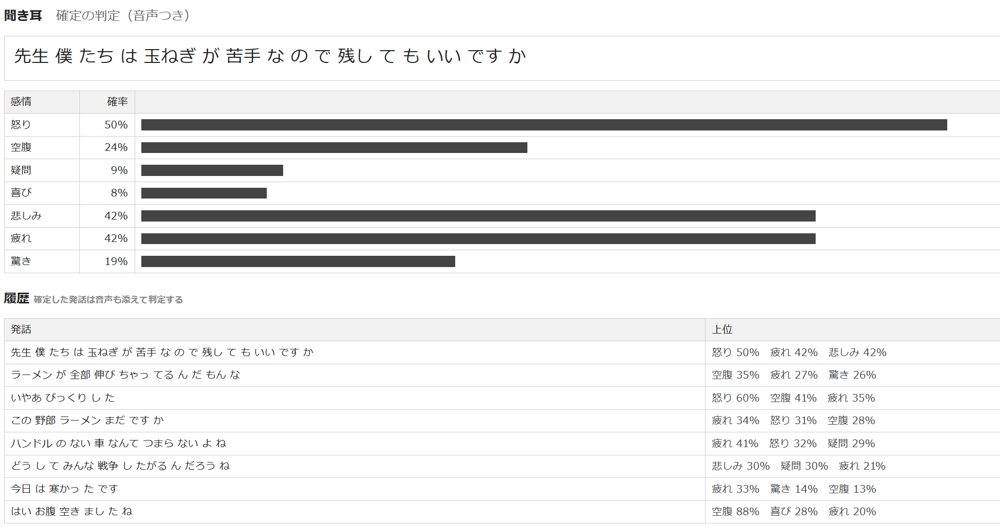

# kikimimi（聞き耳）

マイクに向かって話すと、日本語の書き起こしがその場で表示され、Gemini Decision 1（Decisions API）が怒り・空腹・疑問・喜び・悲しみ・疲れ・驚きのそれぞれについて確率を出すローカルアプリです。

動作イメージ




## 必要なもの

- [uv](https://docs.astral.sh/uv/)
- Chrome（書き起こしにブラウザの Web Speech API を使う。音声はブラウザの提供元の音声認識サービスで処理される）
- Gemini API の API キー、またはアプリケーションのデフォルト認証情報（ADC）

## 起動

```sh
GOOGLE_AI_STUDIO_KEY=<key> ./server.py [port]
```

http://localhost:18960/ を開き、マイクを許可します。

## 認証

API キーは `GOOGLE_AI_STUDIO_KEY` から読み、`x-goog-api-key` ヘッダで付けます。キーの API 制限に `generativelanguage.googleapis.com` を含める必要があります。

`GOOGLE_AI_STUDIO_KEY` が無いときは ADC を使います。課金先のプロジェクトは `GOOGLE_CLOUD_PROJECT` で渡します。トークンには `generative-language` スコープが必要で、gcloud 標準の OAuth クライアントではこのスコープを要求できないため、自分の OAuth クライアント（デスクトップアプリ）を作ってログインします。

```sh
gcloud auth application-default login \
  --client-id-file=<client_secret.json> \
  --scopes=https://www.googleapis.com/auth/cloud-platform,https://www.googleapis.com/auth/generative-language
GOOGLE_CLOUD_PROJECT=<project-id> ./server.py
```

## 仕組み

- ブラウザ: Web Speech API（`ja-JP`）で途中結果と確定結果を受け取る。確定ごとに MediaRecorder でその発話の音声を webm に切り出す
- `server.py`: `POST /decide` を受けて `POST https://generativelanguage.googleapis.com/v1beta/decisions` を呼ぶ。感情ごとに `noul`（yes/no の確率）の質問を並べる。感情のリストは適当です。
  - 途中結果: テキストだけで判定する。応答待ちの間に届いた分は最新の一件だけを判定する
  - 確定結果: テキストと音声で判定する
- 感情の項目は `server.py` の `EMOTIONS` と `index.html` の `LABELS` にある

SDKを使っていないのは手元でSDKインストール公開後1週間ルールがあったからです。
